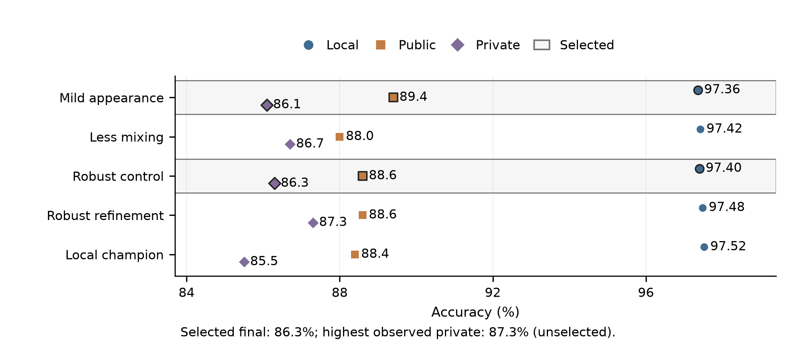

# CIFAR-10 with a five-million-parameter ResNet

**Zicheng Zhou · zz11018 · NYU Tandon Deep Learning, Fall 2026**

[Report](reports/Zicheng_Zhou_Deep_Learning_Project_1_Report.pdf) · [Results notebook](notebooks/reproduction.ipynb) · [Reproduce the models](docs/reproducing.md) · [中文说明](README_zh.md)

This is my project for the [CIFAR-10 ResNet Architecture Challenge](https://www.kaggle.com/competitions/cifar-10-res-net-architecture-challenge-dl). I explored how to improve image classification while keeping the network under five million parameters. I started with short experiments on architecture and training choices, then trained the stronger configurations for longer and used their errors to guide follow-up experiments.

The most effective design was a three-stage Wide ResNet. It reached **97.52% on my validation split**. Mild appearance augmentation gave my highest public leaderboard score, **89.40%**, and the two submissions I selected finished with a **private score of 86.30%**.

## Results

All local results below use the same 5,000-image validation split, CPU FP32, and horizontal-flip averaging.

| Model | Parameters | Validation | Public | Private | Selected |
|---|---:|---:|---:|---:|:---:|
| Mild appearance WRN, SWA | 4,480,474 | 97.36% | **89.40%** | 86.10% | Yes |
| Robust WRN, less mixing, SWA | 4,948,626 | 97.42% | 88.00% | 86.70% | |
| Robust WRN, control, SWA | 4,948,626 | 97.40% | 88.60% | **86.30%** | Yes |
| Robust WRN, 50-epoch refinement, EMA | 4,948,626 | 97.48% | 88.60% | **87.30%** | |
| Best local WRN | 4,480,474 | **97.52%** | 88.40% | 85.50% | |



The leaderboard changed the ranking I saw locally. Mild appearance augmentation worked best on the public split, while the refined robust model had the highest private score among my candidates. The selected final score came from the robust SWA model. The [report](reports/Zicheng_Zhou_Deep_Learning_Project_1_Report.pdf) discusses these results and the experiments that led to them.

## Model and training

The main model is a **WRN-28 with width 3.5**: a 16-channel stem followed by three stages of four pre-activation residual blocks. The stages have 56, 112, and 224 channels. Each block uses two 3 × 3 convolutions, with 1 × 1 projections when dimensions change.

I trained it with SGD, cosine learning-rate decay, RandAugment, Mixup, CutMix, and label smoothing. I compared raw, EMA, and SWA weights. The public-best model adds a 60-epoch stage with mild color jitter, grayscale, and blur, then uses SWA and flip inference.

The robust model uses 58, 116, and 232 channels with squeeze-and-excitation blocks. Its 4,948,626 parameters fit close to the course limit. Both families were trained from scratch on the competition's training data, with a fixed 45,000/5,000 training–validation split.

## What I tried

Across **79 runs and 7,810 training epochs**, I explored:

- Residual depth, channel widths, block allocation, convolution kernels, shortcuts, pooling, and a four-stage design.
- SGD, Adam, AdamW, RMSProp, SAM, learning-rate schedules, and batch sizes.
- Image augmentation, regularization, knowledge distillation, weight averaging, and INT8 quantization.

Three findings shaped the later experiments:

1. The three-stage WRN used the parameter budget well. At 400 epochs, it reached 97.40% locally, compared with 96.80% for the four-stage model.
2. Longer training helped early on, but later low-learning-rate continuations often produced small gains as the curves flattened.
3. Cat–dog confusion accounted for 51 of the local champion's 124 errors. Appearance sensitivity led me to try mild photometric augmentation, followed by matched blur and label-smoothing experiments.

The [experiment archive](archive/README.md) contains the configurations, per-epoch logs, and source variants for the full search.

## Explore the project

- **Read the analysis:** [eight-page report](reports/Zicheng_Zhou_Deep_Learning_Project_1_Report.pdf).
- **View executed code and plots:** [results notebook](notebooks/reproduction.ipynb).
- **Train and evaluate the models:** [reproduction guide](docs/reproducing.md).
- **Edit the report or figures:** [report files](reports/README.md).
- **Look up a method:** [references](REFERENCES.md).

The notebook plots the saved training logs, displays the competition results, and checks the model parameter counts. The reproduction guide covers data preparation, all three main training routes, evaluation, and CSV generation.

## Repository layout

```text
src/dlend/       Model, training, evaluation, and prediction code
configs/         Five configurations for the main reproduction routes
notebooks/       Executed results notebook
results/         Training logs, scores, and experiment summaries
archive/         All 79 experiment configurations and source variants
reports/         Report, editable text, figures, and plotting data
scripts/         Data preparation, notebook execution, and utility commands
```

Training used an RTX 5070 Ti with Python 3.12, PyTorch 2.7.1, and CUDA 12.8. The repository provides the code and recorded experiment outputs; obtain the image archive from the competition page and follow the [setup instructions](docs/reproducing.md).

Method citations are in [REFERENCES.md](REFERENCES.md). Code licenses and third-party credits are in [LICENSE](LICENSE) and [THIRD_PARTY_NOTICES.md](THIRD_PARTY_NOTICES.md).
