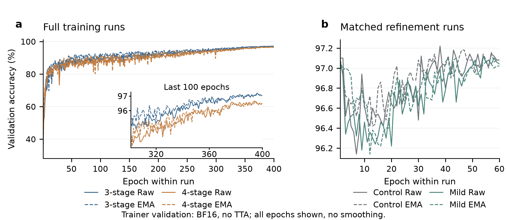
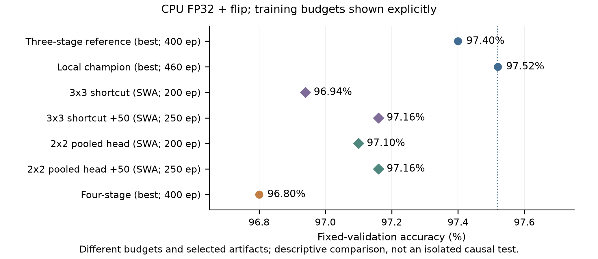
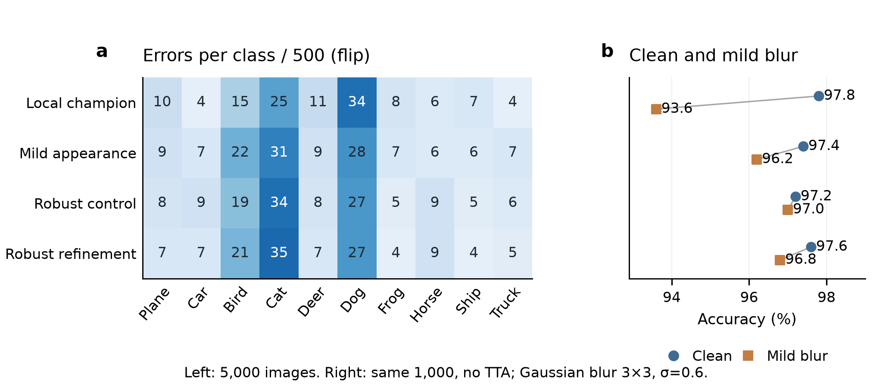
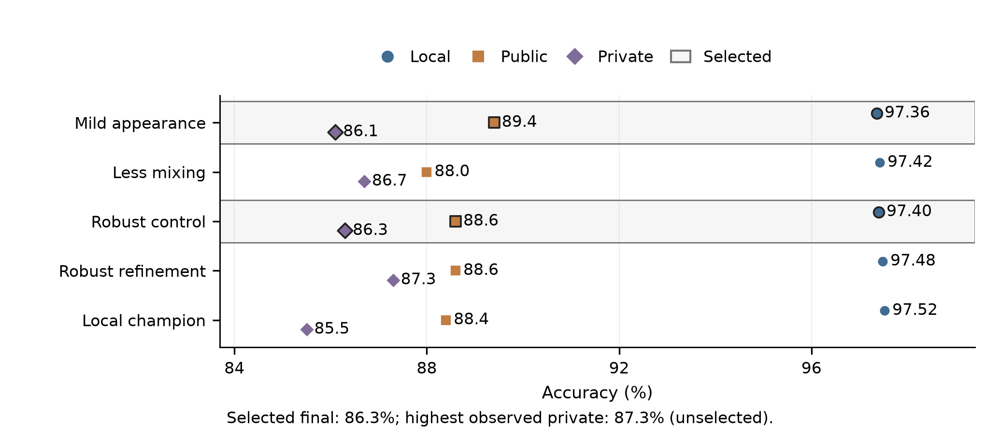

# Residual Network Design Under a Five-Million-Parameter Budget

Deep Learning Project 1 | Fall 2026

Zicheng Zhou (zz11018) | Individual project | November 9, 2026

Public code repository: https://github.com/nyu-zzc/cifar10-resnet-project

## Abstract

This project explores how to improve CIFAR-10 classification with a residual network containing fewer than five million parameters. I compared network structures, training recipes, and data augmentation through 79 runs totaling 7,810 epochs. The strongest local model was a three-stage Wide Residual Network with 4,480,474 parameters, reaching 97.52% validation accuracy. Adding mild appearance augmentation produced my highest public leaderboard score of 89.40%. My final selected submissions achieved 86.30% on the private leaderboard. Error analysis showed that cat-dog confusion and sensitivity to image appearance were recurring problems. I used these findings to guide further experiments with blur augmentation, label smoothing, and low-learning-rate training. The three-stage network remained my most effective design, combining a compact architecture with a well-developed training recipe.

## 1 Task and evaluation

The course competition asked for a modified ResNet [1] with at most 5,000,000 trainable parameters. I used the supplied 50,000 labeled 32 × 32 RGB images and 2,000 test images. A stratified split with seed 42 assigned 45,000 images to training and 5,000 to validation, with 500 validation images per class. I kept this split fixed throughout the project and trained the models from random initialization using the competition training data.

I measured local accuracy on the fixed validation set and used Kaggle scores to assess competition performance. Final model comparisons used CPU FP32 inference with two threads and batch size 64. For flip inference, I averaged each model’s predicted probabilities for the original image and its horizontal flip. I also evaluated brightness, darkness, grayscale, and mild blur on a fixed, stratified subset of 1,000 validation images, comparing each transformation with the original images.

<!-- PAGE BREAK -->

## 2 Model design and training

I built the main model around pre-activation residual blocks [2] and the Wide Residual Network design [3]. It has a 16-channel stem and three stages, each containing four blocks. Each block uses two 3 × 3 convolutions, with 1 × 1 projections where feature dimensions change. Global average pooling feeds the final classifier. The width multiplier of 3.5 gives stage widths of 56, 112, and 224 while keeping the model comfortably within the parameter budget.

**Table 1. Main model architectures.**

| Model | Blocks / stage widths | Parameters |
| --- | --- | --- |
| WRN-28 × 3.5 | [4,4,4] / [56,112,224] | 4,480,474 |
| Robust WRN + SE | [4,4,4] / [58,116,232] | 4,948,626 |
| Four-stage residual net | [3,3,3,3] / [32,65,130,260] | 4,496,043 |
| Efficient ResNet | [4,4,3] / [64,128,256] | 4,697,742 |

I explored three other designs alongside this WRN. The robust model uses slightly wider stages and squeeze-and-excitation (SE) blocks with a bottleneck fraction of 0.25 [4]. The four-stage model redistributes the 12 residual blocks across four stages and reduces feature-map sizes through 32, 16, 8, and 4 pixels. The Efficient ResNet baseline [20] uses post-activation blocks and places SE after the stem. These designs offered different ways to allocate the available parameters.

## 2.1 Main training recipe

The main WRN recipe uses 400 epochs of SGD with Nesterov momentum 0.9, weight decay 0.0005, and batch size 128. After five warmup epochs, the learning rate follows cosine decay [5] from 0.1 to 0.0001. Images receive a random crop with four-pixel reflection padding, horizontal flipping, and RandAugment with N = 2 and M = 7 [6]. Normalization uses mean (0.4914, 0.4822, 0.4465) and standard deviation (0.2470, 0.2435, 0.2616). I combine Mixup alpha 0.2 [7], CutMix alpha 1.0 [8], mixing probability 0.8, and label smoothing 0.05 [9].

I saved raw weights, an exponential moving average (EMA) with decay capped at 0.999, and stochastic weight averaging (SWA) checkpoints [10]. SWA begins at epoch 300 in the 400-epoch recipe. It averages later checkpoints and then updates batch-normalization statistics on the training set. I compared these weight choices on validation accuracy before exporting submissions.

## 2.2 Mild appearance augmentation

My highest-public-score model continues from WRN epoch 396 for another 60 epochs. This stage uses learning rates from 0.003 to 0.00001, three warmup epochs, and SWA over epochs 45–60. I added color jitter 0.15, hue jitter 0.0375, grayscale probability 0.05, and Gaussian-blur probability 0.03 with a 3 × 3 kernel and sigma sampled from 0.1 to 1.0. The submission uses SWA and flip inference. This branch consumed 460 training epochs in total; its selected weight path spans 396 + 60 epochs.

<!-- PAGE BREAK -->

## 3 Experiment plan

I organized the search in three steps: short screening runs, longer training of promising configurations, and targeted follow-up experiments. The project completed 79 runs and 7,810 epochs: 39 screens totaling 1,980 epochs, 18 full training runs totaling 4,400 epochs, and 22 continuations totaling 1,430 epochs. Logged epoch times add up to 46.10 hours. The experiments covered the architectural and training choices summarized in Table 2.

**Table 2. Architectural and training choices explored in the project.**

| Design dimension | Settings tested |
| --- | --- |
| Residual architecture | Depth 16/22/28/40; nonuniform block allocation; channel widths; three/four stages |
| Convolution and shortcuts | 3 × 3 / 5 × 5 main kernels; projection / zero-padding / average-pool projection; 3 × 3 projection |
| Pooling | Global average, max, average–max, and a 4 × 4 pool retaining a 2 × 2 feature grid |
| Optimization and schedule | SGD, Adam, AdamW, RMSProp, SAM; cosine, linear, multistep; batch sizes 64/128/256 |
| Augmentation | RandAugment, AutoAugment, Mixup, CutMix, Cutout, random erasing, single-view AugMix, photometric transforms |
| Regularization and deployment | Weight decay, dropout, stochastic depth, label smoothing, EMA, SWA, knowledge distillation, INT8 |

Figure 1. Validation accuracy during training. The plots show raw and EMA weights for the 400-epoch architecture comparison and the matched appearance-augmentation continuations.

Short runs helped narrow the search. In the 40-epoch screen, Mixup-only reached 95.46% versus 94.94% for the baseline. In the 60-epoch screen, custom channel widths reached 95.90% versus 95.60%. These training-time BF16 results guided the longer runs. I also tested Adam and AdamW [14,15], SAM [16], AutoAugment [17], Cutout [18], and teacher-student distillation [19]. For follow-up experiments, I kept the source checkpoint and training schedule fixed where possible and changed the setting being investigated.

<!-- PAGE BREAK -->

## 4 Architecture and training results

Figure 2. Validation accuracy with CPU FP32 and flip inference. The original WRN and the four-stage model both received 400 epochs; the local champion includes an additional continuation stage.

The three-stage WRN gave the strongest results in the architecture comparison. Its 400-epoch model reached 97.40%, and a later continuation reached 97.52%. The four-stage network completed 400 epochs and selected epoch 394, reaching 96.80%; its SWA checkpoint reached 96.70%. Compared with the local champion, the four-stage model corrected 37 images and introduced 73 errors. I therefore retained the three-stage WRN as the main model for further refinement.

**Table 3. Results of the main controlled training experiments. Accuracy is measured in CPU FP32.**

| Comparison / endpoint | Control | Variant | Training and change |
| --- | --- | --- | --- |
| 3 × 3 shortcut, SWA / no flip | 96.80 | 96.78 | 200 epochs; −1 image |
| P4 pooling, SWA / no flip | 96.80 | 96.80 | 200 epochs; tied |
| Efficient ResNet + Mixup, final / no flip | 96.06 | 96.44 | 200 epochs; +19 images |
| Mixup continuation, final / no flip | 96.44 | 96.44 | Additional 50; tied |
| Mixup continuation, final / flip | 96.68 | 96.82 | Additional 50; +7 images |

The larger shortcut kernel and P4 pooling produced results close to their 200-epoch SWA control. Their validation curves were still rising near the end, so I added 50 low-learning-rate epochs to each. Both then reached 97.16% with SWA and flip inference. This gave a useful improvement within those branches, while the original WRN remained ahead.

I also trained the Efficient ResNet [20] for 200 epochs using its SGD/Lookahead recipe [11]. Its best accuracy without flip inference was 96.18%. Adding Mixup raised the final-epoch accuracy from 96.06% to 96.44%, a gain of 19 correct images. A further 50 epochs kept that value at 96.44%, while flip inference raised the result to 96.82%. The extra training had reached a plateau on the main validation measure.

<!-- PAGE BREAK -->

## 5 Error analysis and targeted improvements

I inspected the local champion’s 124 validation errors to decide what to try next. Cat-dog confusion accounted for 51 errors: 21 cats were predicted as dogs, and 30 dogs as cats. The correct class ranked second in 91 errors. Many difficult examples contained small subjects, unusual poses, occlusion, or weak facial detail. The local champion and the refined robust model shared 80 errors, making these recurring examples a useful focus for analysis.

Figure 3. Error distribution and sensitivity to blur. The right panel compares original and blurred versions of the same 1,000 validation images.

**Table 4. Targeted 50-epoch refinements from the same WRN checkpoint, evaluated with SWA and flip inference.**

| Intervention | Control | Variant | Net correct / 5,000 |
| --- | --- | --- | --- |
| Blur probability 0.05, seed 42 | 97.34 | 97.38 | +2 |
| Blur probability 0.05, seed 43 | 97.42 | 97.32 | −5 |
| Label smoothing 0.05 → 0, seed 42 | 97.34 | 97.38 | +2 |

Mild appearance augmentation was the most useful follow-up for competition performance. It matched its control at 97.36% local accuracy and improved accuracy on blurred images from 94.30% to 96.20%. I kept this candidate for submission, and it later achieved the highest public score. I then tested blur alone at probability 0.05. Its local changes were small and mixed across seeds: two additional correct images with seed 42 and five fewer with seed 43.

I also examined prediction confidence. The local champion’s mean confidence was 86.24%, compared with 97.52% accuracy, which motivated a trial with label smoothing reduced from 0.05 to zero. With Mixup and CutMix retained, this change added two correct SWA predictions. Single-view AugMix [12] also gave limited gains in the matched continuation trials. These experiments helped me prioritize the mild-appearance and robust candidates for the remaining submissions.

<!-- PAGE BREAK -->

## 6 Competition results

**Table 5. Kaggle results for the five final candidates. All use flip inference.**

| Submission / model | Params (M) | Local (%) | Public (%) | Private (%) | Selected |
| --- | --- | --- | --- | --- | --- |
| Mild appearance SWA / WRN | 4.480 | 97.36 | 89.40 | 86.10 | Yes |
| Less mixing SWA / Robust | 4.949 | 97.42 | 88.00 | 86.70 | No |
| Control SWA / Robust | 4.949 | 97.40 | 88.60 | 86.30 | Yes |
| Refine50 best / Robust | 4.949 | 97.48 | 88.60 | 87.30 | No |
| Local champion / WRN | 4.480 | 97.52 | 88.40 | 85.50 | No |

Figure 4. Local validation, public leaderboard, and private leaderboard accuracy for the final candidates. Outlined rows mark the two selected submissions.

Mild appearance augmentation achieved the highest public score, 89.40%. I selected that submission together with the robust control model, giving a final private score of 86.30%. Among all submitted candidates, the refined robust model reached the highest private accuracy of 87.30%. Table 5 records the selection status alongside each score.

The leaderboard results changed how I judged the models. The local champion led on the validation split, while mild appearance augmentation performed best publicly and the refined robust model performed best privately. This showed the value of retaining candidates with different strengths. For future projects, I would add a second validation split before final model selection and use performance across both splits to assess generalization.

<!-- PAGE BREAK -->

## 7 Deployment and reproducibility

I tested post-training INT8 quantization [13] to reduce inference cost. The experiment quantized 28 convolutional layers and one linear layer, using 1,024 training images for calibration. Accuracy on the full validation set changed from 97.30% in FP32 to 97.26% in INT8. The TorchScript file shrank to about 1/3.80 of its original size, and two-thread CPU throughput reached about 1.94 times the FP32 throughput. This was a practical trade-off: a loss of two correct predictions for substantially smaller storage and faster CPU inference.

The public repository on the first page contains the training code, model definitions, configurations, reproduction commands, and an executed results notebook. It also includes saved experiment summaries and the source data for the figures. The notebook displays the reported scores and parameter counts, while the training commands reproduce each main model from the competition data. Submission generation checks all 2,000 IDs, their order, and the predicted class range.

The highest-public-score model follows a direct training path: train the WRN for 400 epochs, load raw checkpoint 396, run the 60-epoch mild-appearance stage, then use SWA over epochs 45–60 with flip inference. The final selected robust model starts with 300 epochs, continues from EMA checkpoint 285 for 60 epochs, and uses the resulting SWA checkpoint. Its robust recipe combines RandAugment N = 2, M = 5, color jitter 0.2, grayscale probability 0.1, blur probability 0.05, and Mixup alpha 0.4 with mixing probability 0.6. A later 50-epoch stage selected EMA checkpoint 29 and produced the 87.30% private result.

## 8 What I learned

Working within the parameter limit made architecture design a question of allocation. The three-stage WRN used the budget effectively, and its wider features supported strong results across several training recipes. The four-stage experiment helped settle that design choice for this project. Training duration mattered early in development, but later continuations often produced smaller gains as the curves flattened. Comparing the curves and the actual error cases helped me decide where to spend the remaining training time.

My main result is a compact residual-network pipeline that reached 97.52% local accuracy and 89.40% public accuracy, with 86.30% as the final selected private score. The most useful improvement for the public leaderboard came from mild appearance augmentation. The project also taught me to treat model selection as part of the experiment: the strongest local score was one useful signal, and the behavior under image changes added another. I would carry this combination of controlled comparisons, error inspection, and broader validation into future work.

<!-- PAGE BREAK -->

## References

[1] K. He, X. Zhang, S. Ren, and J. Sun. Deep Residual Learning for Image Recognition. CVPR, 2016. [Link](https://arxiv.org/abs/1512.03385).

[2] K. He, X. Zhang, S. Ren, and J. Sun. Identity Mappings in Deep Residual Networks. ECCV, 2016. [Link](https://arxiv.org/abs/1603.05027).

[3] S. Zagoruyko and N. Komodakis. Wide Residual Networks. BMVC, 2016. [Link](https://arxiv.org/abs/1605.07146).

[4] J. Hu et al. Squeeze-and-Excitation Networks. arXiv:1709.01507, 2017. [Link](https://arxiv.org/abs/1709.01507).

[5] I. Loshchilov and F. Hutter. SGDR: Stochastic Gradient Descent with Warm Restarts. ICLR, 2017. [Link](https://arxiv.org/abs/1608.03983).

[6] E. D. Cubuk, B. Zoph, J. Shlens, and Q. V. Le. RandAugment: Practical Automated Data Augmentation with a Reduced Search Space. arXiv:1909.13719, 2019. [Link](https://arxiv.org/abs/1909.13719).

[7] H. Zhang, M. Cisse, Y. N. Dauphin, and D. Lopez-Paz. mixup: Beyond Empirical Risk Minimization. ICLR, 2018. [Link](https://arxiv.org/abs/1710.09412).

[8] S. Yun et al. CutMix: Regularization Strategy to Train Strong Classifiers with Localizable Features. ICCV, 2019. [Link](https://arxiv.org/abs/1905.04899).

[9] C. Szegedy et al. Rethinking the Inception Architecture for Computer Vision. CVPR, 2016. [Link](https://arxiv.org/abs/1512.00567).

[10] P. Izmailov et al. Averaging Weights Leads to Wider Optima and Better Generalization. UAI, 2018. [Link](https://arxiv.org/abs/1803.05407).

[11] M. R. Zhang, J. Lucas, G. Hinton, and J. Ba. Lookahead Optimizer: k Steps Forward, 1 Step Back. NeurIPS, 2019. [Link](https://arxiv.org/abs/1907.08610).

[12] D. Hendrycks et al. AugMix: A Simple Data Processing Method to Improve Robustness and Uncertainty. ICLR, 2020. [Link](https://arxiv.org/abs/1912.02781).

[13] B. Jacob et al. Quantization and Training of Neural Networks for Efficient Integer-Arithmetic-Only Inference. CVPR, 2018. [Link](https://arxiv.org/abs/1712.05877).

[14] D. P. Kingma and J. Ba. Adam: A Method for Stochastic Optimization. ICLR, 2015. [Link](https://arxiv.org/abs/1412.6980).

[15] I. Loshchilov and F. Hutter. Decoupled Weight Decay Regularization. ICLR, 2019. [Link](https://arxiv.org/abs/1711.05101).

[16] P. Foret et al. Sharpness-Aware Minimization for Efficiently Improving Generalization. ICLR, 2021. [Link](https://arxiv.org/abs/2010.01412).

[17] E. D. Cubuk et al. AutoAugment: Learning Augmentation Policies from Data. CVPR, 2019. [Link](https://arxiv.org/abs/1805.09501).

[18] T. DeVries and G. W. Taylor. Improved Regularization of Convolutional Neural Networks with Cutout. arXiv:1708.04552, 2017. [Link](https://arxiv.org/abs/1708.04552).

[19] G. Hinton, O. Vinyals, and J. Dean. Distilling the Knowledge in a Neural Network. arXiv:1503.02531, 2015. [Link](https://arxiv.org/abs/1503.02531).

[20] A. Thakur, H. Chauhan, and N. Gupta. Efficient ResNets: Residual Network Design. arXiv:2306.12100, 2023. [Link](https://arxiv.org/abs/2306.12100).

## Implementation details

Experiments ran on an NVIDIA GeForce RTX 5070 Ti with Windows 11, Python 3.12.10, PyTorch 2.7.1+cu128, torchvision 0.22.1+cu128, and CUDA 12.8. WRN training mainly used BF16 and channels-last layout; final inference used CPU FP32. The Efficient ResNet implementation is credited to Thakur et al. [20] and github.com/Nikunj-Gupta/Efficient_ResNets, with its original MIT notices retained.
